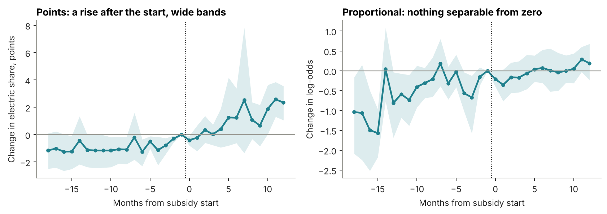

# Did state EV subsidies raise electric two-wheeler adoption?

Difference-in-differences on a state-by-month Vahan panel for India.

**Answer: suggestive, not proven, and small where it matters.** Six states that paid purchase subsidies gained 1.1 to 2.0 points of electric share in the first year, depending on the estimator. Weighted by registrations that is 0.3 to 0.7 points. Without Goa it is 0.4. Read [`POLICY_NOTE.md`](POLICY_NOTE.md).



## Data

- **Registrations:** 36 states and UTs, 118 months, January 2017 to October 2026, captured from the official Vahan dashboard. All two-wheelers, and electric ones.
- **Policy table:** 50 policy spells covering all 36 units, with start and end dates, amounts, sources and confidence, in `data/policy/`. Each row separates what was legally in force from whether money reached buyers.

## Method

- Written plan before any estimate: [`docs/ANALYSIS_PLAN.md`](docs/ANALYSIS_PLAN.md). Later changes are listed in the note.
- Callaway-Sant'Anna ATT with never-treated controls, hand-written in `scripts/common.py`, and matched to the `csdid` package.
- Event study for pre-trends, state cluster bootstrap, and randomisation inference because six treated clusters is too few for clustered errors alone.
- Placebo dates, placebo outcome, leave-one-out, imputation with state trends, and alternative treatment coding.

## Repo

| Path | Contents |
|---|---|
| `POLICY_NOTE.md` | Verdict, numbers, limits |
| `notebooks/` | Coverage, event study, robustness, all executed |
| `scripts/` | Capture, panel build, estimator, reconciliation |
| `data/` | Raw capture, processed panel, policy table, treatment coding |
| `outputs/` | Tables, charts, `metrics.json` |
| `docs/` | Analysis plan, data quality log |

## Run it

```
pip install -r requirements.txt
./scripts/run_all.sh
```

About 15 minutes. `scripts/reconcile.py` rebuilds the headline with plain pandas and checks the panel, treatment counts and library match. It does not check the text of the note.
